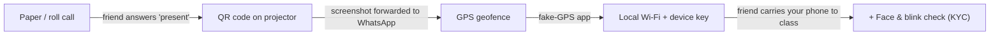
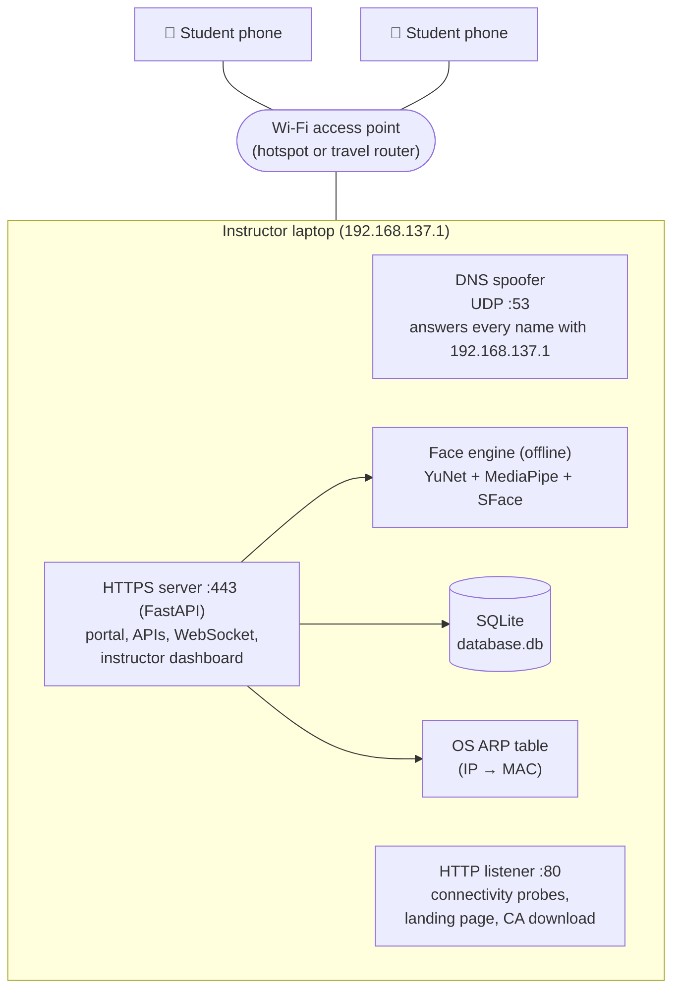
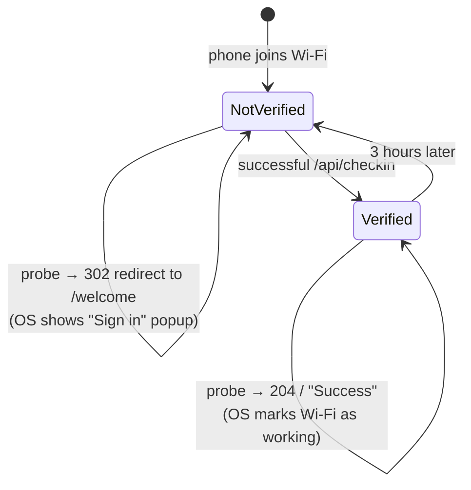
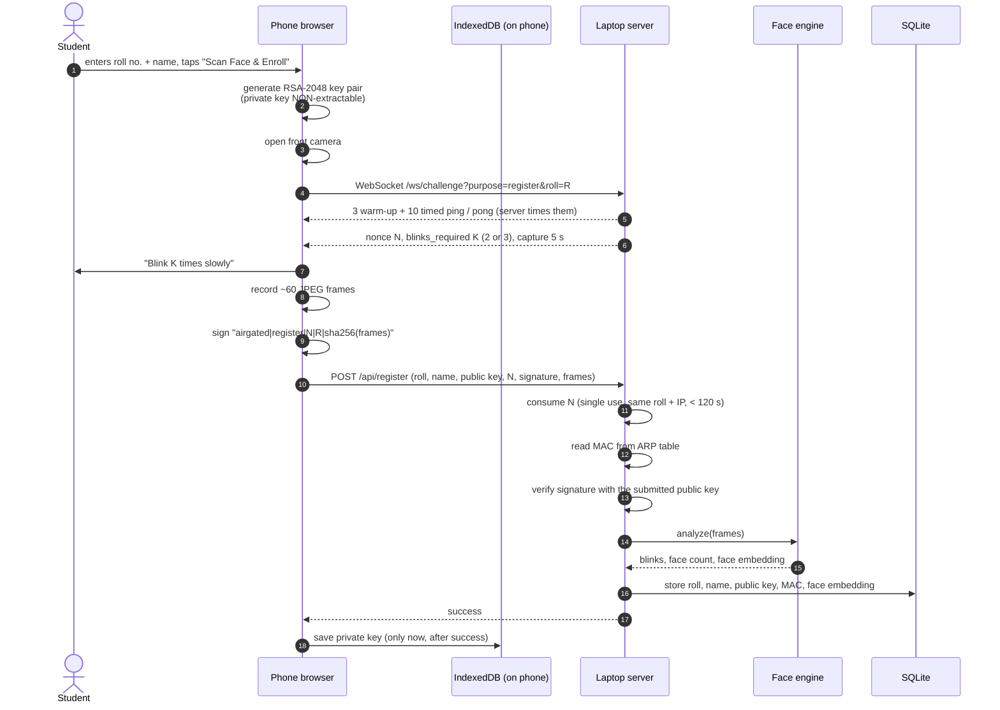
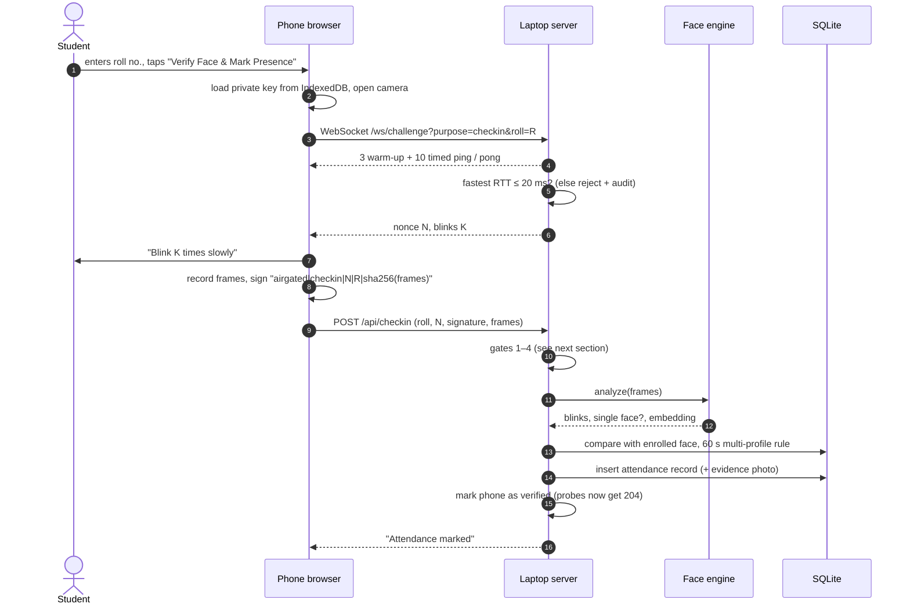
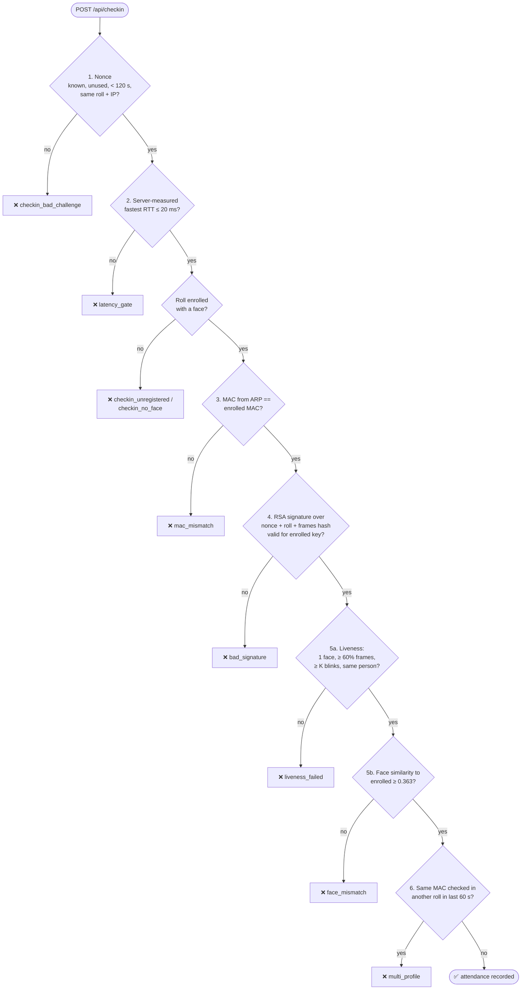
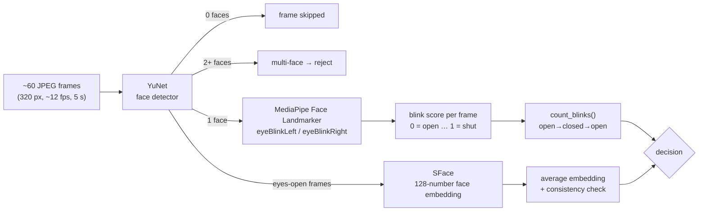
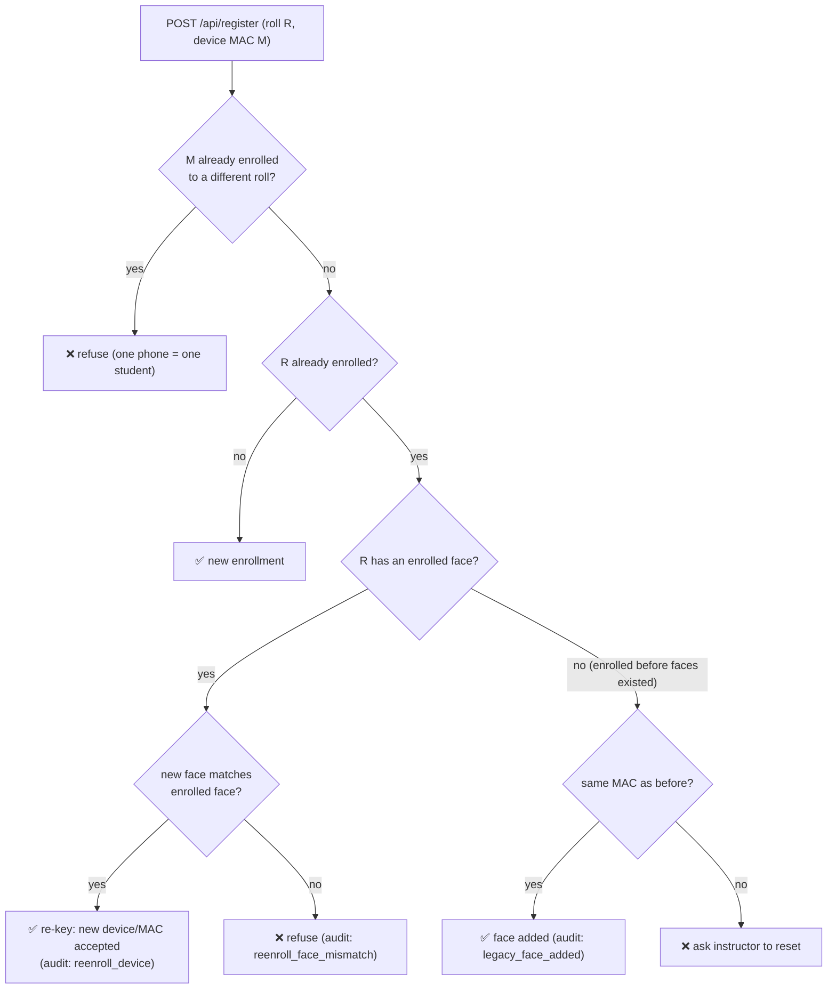
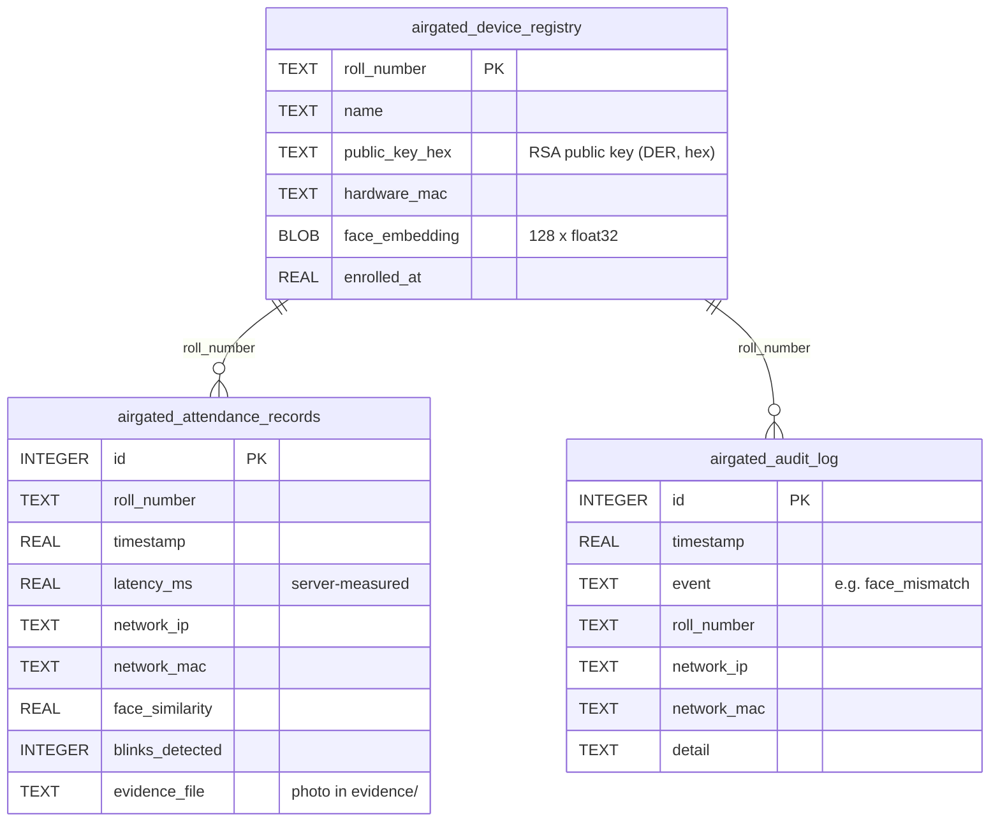
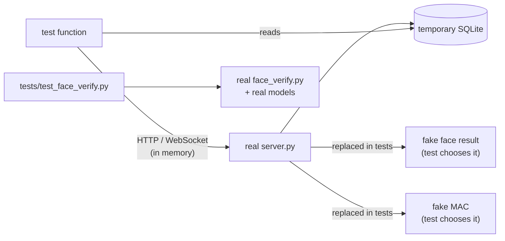

# AirGated

**Offline classroom attendance with device binding and a KYC-style face + blink check.**

Repository: <https://github.com/unexperiencedone/airgated->

> **Acknowledgement:** I designed AirGated, made the design decisions and tested it with real students
> and phones. I used Claude (Anthropic's AI coding assistant) to help me write most of the code, tests
> and documentation.

The instructor's laptop creates a Wi-Fi network. Students join it and check in on their phones.
To be marked present, a student has to prove all of the following at the same moment:

- they're on the classroom network, and on it directly rather than through a tunnel;
- they're using the phone they enrolled with;
- they're a live person who blinks when asked, not a photo;
- their face matches the one recorded at enrollment.

Everything runs on the laptop. No cloud service is involved in attendance.

> Diagrams in this file use [Mermaid](https://mermaid.js.org/). GitHub draws them automatically.

---

## Contents

1. [The big picture](#1-the-big-picture)
2. [Network layout](#2-network-layout)
3. [How a phone finds the portal (captive portal)](#3-how-a-phone-finds-the-portal-captive-portal)
4. [Enrollment (day 1)](#4-enrollment-day-1)
5. [Daily check-in](#5-daily-check-in)
6. [The six verification gates](#6-the-six-verification-gates)
7. [How the face + blink check works](#7-how-the-face--blink-check-works)
8. [Re-enrollment and device changes](#8-re-enrollment-and-device-changes)
9. [Database](#9-database)
10. [Threat model: what each attack runs into](#10-threat-model-what-each-attack-runs-into)
11. [Files in this repo](#11-files-in-this-repo)
12. [Setup and running a class](#12-setup-and-running-a-class)
13. [Testing: what the tests are and why they prove something](#13-testing-what-the-tests-are-and-why-they-prove-something)
14. [Status: what's fixed and what's still open](#14-status-whats-fixed-and-whats-still-open)

---

## 1. The big picture

Each earlier approach to attendance was beaten by a cheap trick. Each layer of AirGated exists to
block one of those tricks:



| Cheap trick | What stops it now |
|---|---|
| Friend says "present" for you | Your face must match your enrollment |
| Forwarding a QR / screenshot | There is no QR; every check-in signs a fresh one-time server nonce |
| Fake GPS | GPS isn't used; you must be on the classroom Wi-Fi with low latency |
| Logging in from home over a VPN or tunnel | The server measures round-trip time itself and rejects slow links |
| Copying your "login" to a friend's phone | The device key can't be exported from the phone's browser |
| Holding up a photo of the absent student | Liveness requires a random number of blinks |
| One phone checking in several students | One MAC address can only check in one roll number per 60 seconds |

---

## 2. Network layout



| Port | Protocol | Who uses it | Purpose |
|---|---|---|---|
| 53 | UDP | the phone's OS | Every DNS lookup resolves to the laptop, so all traffic comes here |
| 80 | HTTP | the phone's OS and the sign-in popup | Connectivity probes, the landing page, and download of the classroom certificate |
| 443 | HTTPS | the student's browser | Portal page, challenge WebSocket, `/api/register`, `/api/checkin` |
| 443 (localhost only) | HTTPS | the instructor | `/admin` attendance dashboard + enrollment reset |

HTTPS is required because browsers only allow the camera (`getUserMedia`) and device keys
(`crypto.subtle`) on secure pages.

---

## 3. How a phone finds the portal (captive portal)

When a phone joins Wi-Fi, its operating system quietly fetches a known URL, for example
`http://connectivitycheck.gstatic.com/generate_204`, to answer the question "is there internet here?". The
answer decides what the phone does next:

| OS gets back | OS concludes | What the user sees |
|---|---|---|
| `204 No Content` (or the OS's expected "Success" page) | "Internet works" | Nothing. No popup appears. |
| A redirect (`302`) | "There's a login page here" | The **"Sign in to network"** popup opens |
| Connection refused | "This network is broken" | "No internet", and no popup |

The old `server.py` answered `204` to everyone, so phones decided the network was already open and
never showed the popup. That was the cause of the problem in Finding 4.2b. The server now keeps
track of which phones have checked in and answers differently for each:



The popup is a small built-in browser that usually **can't use the camera**. So the landing page
it shows (`templates/landing.html`) tells the student to open
`https://192.168.137.1/generate-captive-window` in Chrome or Safari. It also offers the classroom
certificate for a one-time install.

---

## 4. Enrollment (day 1)

Enrollment creates a key pair on the phone and records the student's face on the laptop.



Two details matter here:

- **The private key never leaves the phone.** It's created with `extractable: false` and stored as
  a `CryptoKey` object in IndexedDB. Even the page's own JavaScript can't read its bytes, so it
  can't be copied to another phone (the fix for Finding 4.1).
- **The key is saved only after the server accepts the enrollment.** Otherwise a failed enrollment
  would leave behind a key that makes the page think the phone is enrolled.

---

## 5. Daily check-in



---

## 6. The six verification gates

Every check-in passes through these gates in order. Any failure stops it, and the reason is
written to the audit log.



| Gate | What it proves | Why the phone can't fake it |
|---|---|---|
| 1. Nonce | This request is fresh and meant for this roll number and this phone | The server created the nonce and deletes it on first use |
| 2. Latency | The phone is directly on the classroom network | The server times the pings itself. The phone never reports a number. |
| 3. MAC | The request comes from the enrolled phone's network card | The laptop reads the MAC from its own ARP table |
| 4. Signature | The request comes from the enrolled phone's secret key | The key can't be exported, and the signature covers the exact frames |
| 5. Face | A live person who matches the enrolled face is holding the phone | The laptop analyzes the frames, not the phone |
| 6. Multi-profile | One phone isn't marking several students present | The server checks its own records |

---

## 7. How the face + blink check works

Three small models run locally on the laptop. `python fetch_models.py` downloads them once and checks
their checksums.



**Counting blinks.** Each frame gets an "eyes closed" score. A blink is counted when the score goes
from *open* (≤ 0.25) to *closed* (≥ 0.45) and back to *open*. Keeping a gap between the two
thresholds (called hysteresis) means one slow blink isn't counted twice. Squinting is never counted,
because it never crosses 0.45.

```
score  1.0 ┤
           │        ██              ██
  0.45 ┼───┼───────████─────────────████──────── closed line
           │       ████             ████
  0.25 ┼───┼──────██████───────────██████─────── open line
           │██████      ███████████      ██████
  0.0  ┤
           open → closed → open = 1     open → closed → open = 2
```

**Matching the face.** SFace turns a face into 128 numbers (an "embedding"). Photos of the same
person give similar numbers. The *cosine similarity* between two embeddings runs from −1 to 1, and
OpenCV's recommended "same person" threshold for SFace is **0.363**. At enrollment the laptop stores
the average embedding. At check-in it computes a new one and compares the two.

**Same-person consistency.** Every embedding sampled from the clip must also match the clip's own
average. So a clip that starts with the enrolled student and switches to someone else fails.

**Why a random number of blinks?** A fixed number could be satisfied by one pre-recorded clip. A
random number (2 or 3), revealed only after the nonce is issued, makes a recording less likely to
fit. Section 14 covers what this still doesn't stop.

---

## 8. Re-enrollment and device changes

Students clear browser data, change phones, and (with MAC randomization) show up with a new MAC
address. The old code handled this by silently overwriting whichever roll number was registered
to that MAC. The rules are now:



**Re-keying also needs the old key.** A re-key is accepted only if the request is signed by the currently
enrolled key *and* the new face matches (`reenroll_no_old_key` otherwise). A phone that is lost or a browser
that was cleared has no old key, so it needs an instructor reset. If only the MAC changed and the key and
face verify at check-in, the student is offered this re-registration (`mac_changed_verified`).

If a student loses their phone, the instructor uses **Reset a student's enrollment** on the `https://localhost/admin` dashboard. That deletes the old key and face so the student can enroll again from the new phone. Every reset is logged (`instructor_reset`).

---

## 9. Database



New columns are added to an existing `database.db` automatically when the server starts. The
database holds personal data, so it's **not** committed to git.

Nonces and the list of verified phones are kept in memory only, so a server restart clears them.
That's harmless: students just start their check-in again.

---

## 10. Threat model: what each attack runs into

| Attack | Stopped by | Status |
|---|---|---|
| Replay a captured check-in request | Single-use nonce (gate 1) | ✅ closed |
| Tamper with the reported latency | RTT measured by the server (gate 2) | ✅ closed |
| Check in from outside over VPN or tunnel | Latency gate (gate 2) | ✅ closed |
| Copy the device key to a friend's phone | Non-extractable key + MAC (gates 3–4) | ✅ closed |
| Friend brings your phone to class | Face match (gate 5) | ✅ closed |
| Hold up a photo of the absent student | Blink liveness (gate 5) | ✅ closed |
| One phone checks in several students | Multi-profile rule (gate 6) | ✅ closed |
| Take over someone's roll number by re-registering | Face match needed to re-key (section 8) | ✅ closed |
| Play a *video* of the student blinking into the enrolled phone | only the random blink count | ⚠️ partially open |
| Stand in the hallway within Wi-Fi range | nothing (Wi-Fi range ≠ room walls) | ⚠️ open |

---

## 11. Files in this repo

```
server.py               FastAPI app: DNS spoofer, HTTP :80 listener, portal, challenge
                        WebSocket, /api/register, /api/checkin, /admin dashboard
face_verify.py          Face detection, blink counting, face embeddings (offline)
certs.py                Creates the classroom CA + server certificate once, then reuses them
fetch_models.py         Downloads the 3 face models (checksum-verified)
templates/portal.html   The page students use (HTTPS): enrollment + check-in + camera
templates/landing.html  The page shown in the OS "Sign in" popup (HTTP)
tests/                  Automated tests (see section 13)
archive/                Old prototypes kept for history; not used
requirements.txt        Python dependencies
AirGated_Report.md      Original project write-up (May 2026)
AirGated_Progress_Report.*  Critical-analysis progress report (Aug 2026)
AirGated_Technical_Report_v2.*  Technical report v2.0 (Sep 2026): design, live trial, test evidence
```

Not committed (see `.gitignore`): `.env`, `database.db`, `ssl_certs/`, `models/`, `evidence/`, `.venv/`.

---

## 12. Setup and running a class

**One-time setup (needs internet):**

```bash
python -m venv .venv
.venv\Scripts\activate            # Windows  (macOS/Linux: source .venv/bin/activate)
pip install -r requirements.txt
python fetch_models.py            # ~42 MB into models/
```

**Each class:**

1. Turn Mobile Hotspot **off**.
2. Start the server as Administrator with `python server.py`. It needs ports 53, 80 and 443.
3. Turn the hotspot **on**. The server has to claim port 53 before Windows ICS does.
4. Students join the Wi-Fi, follow the popup to `https://192.168.137.1/generate-captive-window`,
   and check in.
5. On the laptop, open `https://localhost/admin` for the attendance dashboard. It refreshes every 30 s, and you can pick another day.

**What the dashboard shows** (it's read-only apart from the reset form):

| Section | What it tells you |
|---|---|
| Summary cards | Enrolled, present, absent, attendance rate, failed check-ins, and students who failed and were never marked present |
| Why check-ins failed | Bar chart of failure reasons (face mismatch, liveness, MAC, latency, ...) |
| Students present, last 7 days | Daily attendance trend |
| Needs attention | Students who tried, failed, and still aren't marked present, with the reason |
| Present / Absent | Who checked in (time, face-match score, blinks, RTT) and who didn't |
| Failed check-in attempts / Failed enrollments | Every rejected attempt, with time, roll number, reason and detail |
| Reset a student's enrollment | For a lost or replaced phone: deletes the student's key and face so they can enroll again |

**One-time steps for each student:**

- Keep the phone's Wi-Fi address setting unchanged for the class network and use the same network name each time. Phones normally keep one address per network; if it does change, the system offers re-registration (see section 8).
- Optional: install the classroom certificate from `http://192.168.137.1/airgated-ca.crt` to avoid the browser warning.

**Hardware note:** Windows Mobile Hotspot allows only 8 devices. For a full class, use a travel
router and set `AIRGATED_LOCAL_IP` to the laptop's address on it.

**Troubleshooting:** if Brave or Chrome shows a certificate error with no way to continue, clear the
HSTS entry for `192.168.137.1` at `brave://net-internals/#hsts` or `chrome://net-internals/#hsts`.

---

## 13. Testing: what the tests are and why they prove something

### What an automated test is

A test is a small program that **uses your code the way a real user or attacker would, then
checks the result is what it should be**. If the result is wrong, the test fails with a red
`FAILED` and a message showing the mismatch.

Every test has the same three steps, often called *Arrange, Act, Assert*:

1. **Arrange:** set up the situation, for example "a student has enrolled this phone".
2. **Act:** do the one thing being tested, for example "send the same check-in again".
3. **Assert:** check the outcome, for example "the server must say `fraud`".

Run all of them with:

```bash
python -m pytest tests        # 39 tests, about 20 seconds
```

### A real example, line by line

This test from `tests/test_server.py` checks that a captured check-in can't be replayed:

```python
def test_replayed_signature_rejected(client):
    device = Device()                                   # ARRANGE: a fake phone with its own RSA key
    enroll(client, device)                              #          enroll it as roll "R1"
    nonce = get_challenge(client, "checkin", "R1")["nonce"]   # ask the server for a check-in nonce
    signature = device.sign("checkin", nonce, "R1")     #          sign it like the real phone does

    assert check_in(client, device, nonce=nonce, signature=signature)["status"] == "success"
                                                        # ACT + ASSERT: first use is accepted
    replay = check_in(client, device, nonce=nonce, signature=signature)
                                                        # ACT: an attacker re-sends the same request
    assert replay["status"] == "fraud"                  # ASSERT: it must be rejected...
    assert "already used" in replay["message"]          #         ...for the right reason
    assert "checkin_bad_challenge" in audit_events()    #         ...and written to the audit log
```

What's real and what's simulated:

- **`client`** is FastAPI's `TestClient`. It sends real HTTP requests and WebSocket messages into
  the real `server.py`, entirely in memory, so no network or admin rights are needed.
- **`Device()`** is a fake phone. It makes a real RSA-2048 key with the `cryptography` library and
  signs messages in exactly the format the browser uses. The server's signature checks are
  therefore genuine.
- **The database** is a fresh temporary SQLite file, so tests never touch your real `database.db`.
- **The face engine is replaced by a stand-in** (`fake_analysis`) in the server tests. A test can't
  blink at a camera, so each test chooses what the face engine "sees": the enrolled face, a
  different face, or too few blinks. This is safe because the real face code is tested separately
  in `tests/test_face_verify.py`.
- **The MAC lookup is replaced** by a function that returns whatever MAC the test wants, because
  there's no real ARP table inside a test.



### How we know the tests actually test something

A test that always passes is worthless. The way to check a test is to **break the code on
purpose and see whether the test notices**. This is called *mutation testing*. It was done for
this repo: seven deliberate bugs were put into a throwaway copy of the code, and the 39-test suite was run
against each one (output in `results/mutation_2026-11-05.txt`).

| Deliberate bug put into the code | Test(s) that caught it |
|---|---|
| Nonce not deleted after use (`CHALLENGES.get` instead of `.pop`) | `test_replayed_signature_rejected` |
| Face-similarity check removed | `test_face_mismatch_rejected` |
| Blink counter counts each blink twice | 4 cases of `test_count_blinks` |
| Probes answered `204` to everyone (the original popup bug) | `test_probe_redirects_until_verified`, `test_http_listener_probe_behaviour` |
| MAC check disabled | `test_mac_changed_with_wrong_face_is_refused_and_lists_every_mismatch` and others |
| Re-key accepted without the enrolled key | `test_reenroll_without_old_key_is_refused_even_with_matching_face` |
| Identity compared only with the clip's mean (a half-and-half face swap passes) | `test_person_swapped_mid_clip_fails` |

Every bug was caught. With the real code, all 39 tests pass.

### What each test checks

**`tests/test_server.py`: the security pipeline**

| Test | Scenario (Arrange → Act) | What must happen (Assert) |
|---|---|---|
| `test_challenge_issued_with_server_measured_rtt` | Open the challenge WebSocket and answer the pings | A nonce is issued, the blink count comes from the server, and the RTT is measured by the server |
| `test_enroll_then_check_in` | Enroll a phone, then check in normally | Success, and the record stores face similarity and blink count |
| `test_replayed_signature_rejected` | Send the identical check-in twice | First accepted, second rejected as `fraud` and audited |
| `test_nonce_for_other_roll_rejected` | Use a nonce issued for another roll number | Rejected |
| `test_expired_challenge_rejected` | Use a nonce older than 120 s | Rejected as expired |
| `test_signature_from_other_device_rejected` | A different phone's key signs for R1 | Rejected, `bad_signature` audited |
| `test_signature_must_cover_submitted_frames` | Sign one clip but upload another | Rejected, because video can't be swapped after signing |
| `test_latency_gate_uses_server_rtt` | Server-measured RTT above the threshold | No nonce issued, `latency_gate` audited |
| `test_rtt_gate_ignores_power_save_spikes` | Ping times from the live trial: honest phone with 100–200 ms power-save spikes, and a relayed link | Honest phone passes on its fastest ping; relayed link (fastest 36 ms) still fails |
| `test_face_mismatch_rejected` | Face engine sees a different person | Rejected, `face_mismatch` audited |
| `test_not_enough_blinks_rejected` | 1 blink when 2 were asked for | Rejected, and the message mentions blinks |
| `test_mac_mismatch_rejected` | Check-in arrives from a different MAC | Rejected with the MAC message |
| `test_multi_profile_window` | Two roll numbers check in from one MAC within 60 s | Second one rejected, `multi_profile` audited |
| `test_device_cannot_enroll_second_roll` | An enrolled phone tries to enroll another roll number | Refused, `register_device_taken` audited |
| `test_reenroll_requires_face_match` | New phone and MAC for an existing roll number | Wrong face refused. Right face accepted, and the new phone can check in. |
| `test_register_catch_all_does_not_swallow_api` | POST empty forms to the APIs | `422` validation error, **not** `null` (the Finding 4.2 bug) |
| `test_probe_redirects_until_verified` | Probe before and after verification (HTTPS) | `302` before, `204` and Apple "Success" after |
| `test_http_listener_probe_behaviour` | Same on the port-80 app | `302` to `/welcome` before, `204` after |
| `test_portal_uses_non_extractable_indexeddb_key` | Load the portal page | No `localStorage.` use, no key export, key generated with `extractable: false` |
| `test_admin_is_localhost_only` | Open `/admin` from a non-localhost client | `403 Forbidden` |
| `test_dashboard_stats` | One student checks in and another fails the face check | Dashboard shows Present (1), Absent (1), 50%, 1 failed attempt with the reason "Face did not match", and 1 student needing attention |
| `test_reset_lets_student_enroll_new_phone` | A student with a new phone is refused; the instructor resets them | Reset refused from outside the laptop; from the laptop it works, is audited, and the new phone can enroll and check in |

**`tests/test_face_verify.py`: the face logic itself**

| Test | What it checks |
|---|---|
| `test_count_blinks` (6 cases) | Normal blinks, two blinks, a clip that starts and ends mid-blink (0), missing-face frames skipped, squinting not counted, one long blink counted once |
| `test_embedding_round_trip` | A face embedding saved to the database and read back is unchanged |
| `test_liveness_failures` | The right rejection reason for too few blinks, two faces, or a face that's mostly out of view |
| `test_models_reject_blank_frames` | Uses the **real models**: a black image contains no face and fails liveness (skipped if the models aren't downloaded) |

### What the tests can't tell you

The tests prove the **logic** is right. They don't prove that the blink thresholds suit real phone
cameras, that the popup appears on a specific Android or iOS version, or that 67 students at once
stay under 20 ms. Those need a trial with real phones.

---

## 14. Status: what's fixed and what's still open

### Fixed in code (progress-report findings)

| Report item | Problem | Fix |
|---|---|---|
| 4.1 | Private key exportable and stored in `localStorage` | Non-extractable key in IndexedDB; saved only after the server accepts it |
| 4.2 | Catch-all route swallowed the APIs (`null`) | Catch-all registered last, no exempt list; covered by a test |
| 4.2b | OS "Sign in" popup never appeared | Probes redirect until the phone checks in, then return `204`/"Success"; landing page on port 80 |
| 4.3 (software part) | MAC collision silently overwrote registrations | Re-keying requires a face match; one phone can't take another roll number; everything audited |
| 4.6 | Groq API key in source | Key moved out of the code; later the exam generator that needed it was removed entirely, so there's no API key at all |
| 4.7 | New certificate on every restart | CA + certificate created once and reused; CA downloadable for one-time install |
| 4.8 | Three overlapping implementations | Old ones moved to `archive/`; one live path |
| 4.9 | No automated tests | 39 tests, checked with deliberate bugs |
| 4.10 | Git out of date; DB and `__pycache__` tracked | Everything committed; DB and `__pycache__` removed from **all** history and ignored |
| Section 5 | Challenge was a hard-coded constant (replayable forever) | Single-use server nonce bound to roll number, IP and purpose, with a 120 s expiry |
| Section 7 "Later" | Rejections only printed to the console | `airgated_audit_log` table + `/admin` attendance dashboard (who's present or absent, who failed and why, 7-day trend) with enrollment reset |
| *(new)* | Latency came from the phone (`current_rtt`), and only the last ping was timed | Server times 10 pings after 3 warm-ups and gates on the fastest (power-save spikes no longer reject honest phones) |
| *(new)* | Friend could check in with your phone | KYC face + blink check at enrollment and every check-in |

### Still open: software problems (not hardware)

1. **Video replay of a blinking face.** Someone who has the enrolled phone *and* a video of the
   student blinking 2 or 3 times could pass. Stronger liveness, such as a random head turn or a
   look-left/look-right challenge, would make this much harder.
2. **Face threshold not tuned.** 0.363 is OpenCV's general-purpose value. It needs checking on real
   students, lighting and cheap front cameras to balance false rejections against false matches.
3. **Little real-phone testing.** The popup fix, the camera flow and blink detection at about 12 fps
   have been run on a few real phones (a three-student trial and informal sessions), not systematically
   across phone models and browsers.
4. **Camera doesn't work inside the OS popup.** Students must switch to a real browser, which is extra
   friction. This is an OS limitation that software can only work around.
5. **Certificate warning is still possible.** A private IP can't get a publicly trusted certificate,
   so each phone either installs the classroom CA once or clicks through a warning.
6. **Proximity means "on the network", not "in the room".** Wi-Fi reaches hallways. The face check
   proves *who* is holding the phone, not *where* they are.
7. **A changed MAC is not a security boundary.** A student can change their MAC without root (private
   address setting, forgetting the network), which also sidesteps the "one phone, one student" and
   60-second rules; the key and face checks are what remain. If only the MAC changed and key and face
   verify, the student is offered re-registration instead of a rejection.
8. **No rate limiting.** The challenge WebSocket and the APIs don't limit repeated attempts from one phone.
9. **Dashboard has no password.** It relies only on "requests from the laptop itself".
10. **In-memory state.** Nonces and verified phones are lost on restart, and the design assumes a
    single server process.
11. **Performance at class scale is unmeasured.** Face analysis takes a few seconds of CPU per check-in,
    and nobody has measured whether 60+ students close together keep the latency gate reliable.
12. **Biometric data handling.** Face embeddings and evidence photos are stored with no automatic
    deletion and no consent screen, which students and the institution may require.
13. **Video replay and the blink count.** The blink check is a minimum, so a recording with enough blinks
    passes for either requested count. A random head-turn challenge is the planned countermeasure.
14. **Re-keying needs the old key.** A lost phone or cleared browser has no old key, so it needs an
    in-person instructor reset. The key is tied to the portal's address (`192.168.137.1`); changing that
    address would force every student through a reset.
